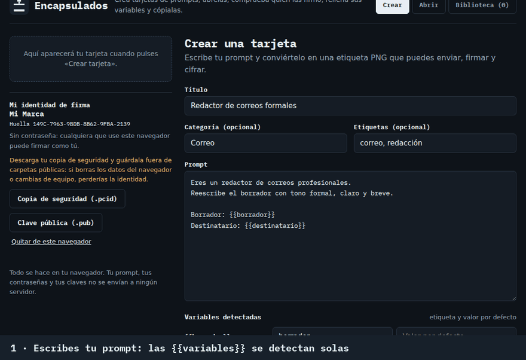
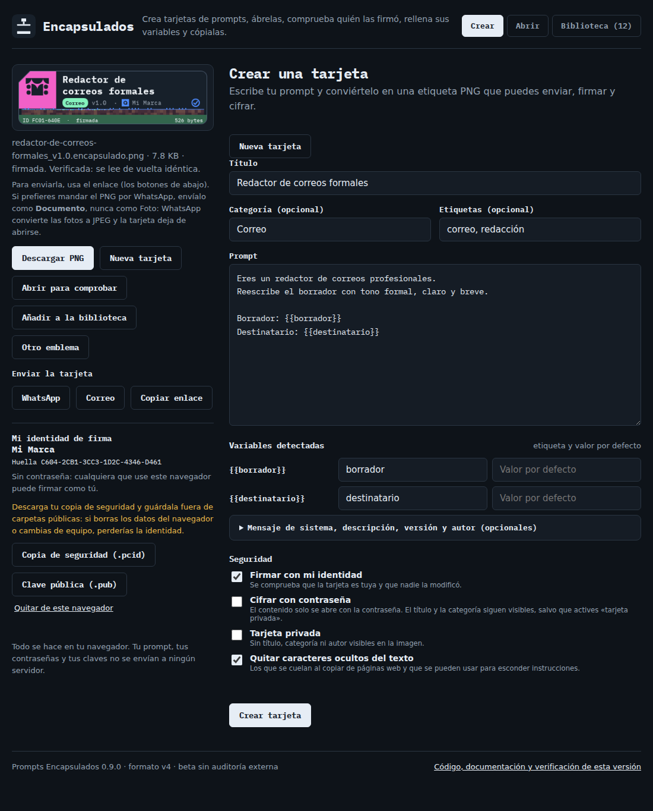
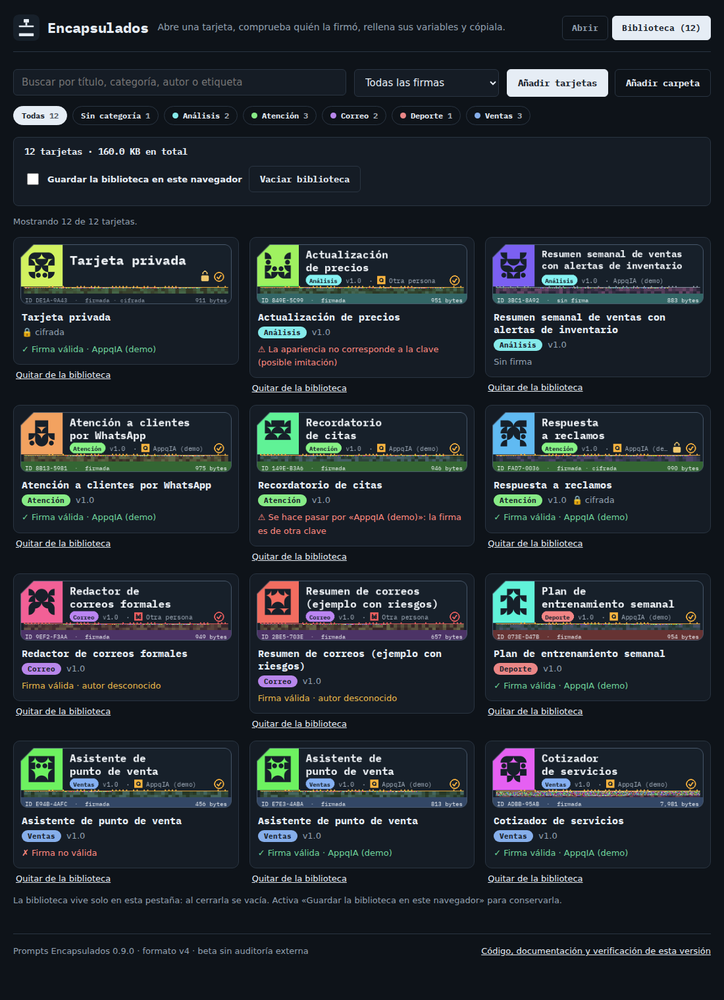

<p align="center">
  
</p>

<h1 align="center">Prompts Encapsulados</h1>
<p align="center"><b>Prompts que se pueden verificar.</b><br>
Crea una etiqueta PNG con tu prompt: comprimido, cifrable con contraseña, firmado por su autor y fácil de encontrar en tu biblioteca. Sin servidor y sin cuenta.</p>

<p align="center">
  <a href="https://oscar-rubalcava.github.io/prompts-encapsulados/app/"></a>
  <a href="https://github.com/oscar-rubalcava/prompts-encapsulados/actions/workflows/ci.yml"></a>
  <a href="LICENSE"></a>
  
</p>

<p align="center"><a href="README.en.md">English</a> · <a href="https://oscar-rubalcava.github.io/prompts-encapsulados/">Sitio</a> · <a href="https://oscar-rubalcava.github.io/prompts-encapsulados/app/"><b>Probar la demo</b></a> · <a href="docs/FORMATO.md">Formato</a> · <a href="docs/SEGURIDAD.md">Seguridad</a></p>

<p align="center"></p>

## ¿Qué problema resuelve?

Los prompts circulan como texto suelto en chats y documentos. No sabes **quién** lo hizo, si alguien lo **cambió**, ni si esconde **instrucciones peligrosas o caracteres invisibles**, y con cientos de archivos es difícil **encontrarlo**. Prompts Encapsulados empaqueta el prompt en una imagen que se puede enviar como cualquier archivo y que el receptor puede **verificar** antes de usarlo.

## Pruébalo en 30 segundos

1. Abre la **[demo en línea](https://oscar-rubalcava.github.io/prompts-encapsulados/app/)**. Todo ocurre en tu navegador: no se sube nada.
2. En la pestaña **Crear**, escribe un título y un prompt (lo que pongas entre `{{llaves dobles}}` será una variable) y pulsa **Crear tarjeta**. Obtienes un PNG que puedes descargar y enviar.
3. Para firmarla, crea tu identidad (un nombre y un color; queda en tu navegador) y marca «Firmar con mi identidad». Descarga la copia de seguridad.
4. Pulsa **Abrir para comprobar**: ves quién la firmó, rellenas las variables y copias el prompt.
5. Para ver los casos difíciles, abre las tarjetas de [`ejemplos/`](ejemplos/): `resumen-de-correos-ejemplo-con-riesgos` (texto oculto) y `actualizacion-de-precios` (una imitación). La tarjeta cifrada usa la contraseña `demo1234`.

<p align="center"></p>

## Qué incluye

- **Creador en el navegador:** escribes el prompt y obtienes la tarjeta PNG, con firma y cifrado opcionales; sin instalar nada y sin servidor.
- **Firma Ed25519** sobre todo el contenido y los datos públicos; lista de autores de confianza y aviso si alguien se hace pasar por uno de ellos.
- **Cifrado opcional** AES-256-GCM con PBKDF2-HMAC-SHA256 (600 000 iteraciones).
- **Bloque público firmado** (título, categoría, etiquetas): la biblioteca indexa incluso las tarjetas cifradas sin contraseña.
- **Biblioteca** con búsqueda, filtros, cuánto ocupa y guardado local opcional en el navegador.
- **Revisión de riesgos del texto:** muestra los caracteres ocultos, decodifica el texto invisible y marca órdenes sospechosas.
- **Detección de imitaciones:** comprueba que el aspecto de la tarjeta corresponde a la clave que la firmó.
- **Sin red:** el decodificador no puede conectarse a ninguna dirección (política CSP).
- **Lanzamientos firmados**, verificables con solo `openssl` ([guía](docs/LANZAMIENTOS.md)).
- **Formato abierto y documentado** ([especificación](docs/FORMATO.md)): puedes escribir tu propio lector.

<p align="center"></p>

## Nombre
El nombre oficial es **Prompts Encapsulados**; en el día a día, **Encapsulados** («te mando un encapsulado»). El comando es `encapsulados` y las tarjetas se guardan como `titulo_v1.0.encapsulado.png`.

## Línea de comandos (opcional)

Para automatizar o crear muchas tarjetas desde la terminal. Necesitas Python 3.10 o superior. Las tarjetas y las identidades que crea son las mismas que las del navegador y se abren entre sí.

```bash
git clone https://github.com/oscar-rubalcava/prompts-encapsulados.git && cd prompts-encapsulados
pip install cryptography pillow

# 1) tu identidad de firma (una vez). Guarda el .pcid en secreto; comparte el .pub
python3 encapsulados.py keygen MiMarca --color "#FBB43F"

# 2) crea una tarjeta desde un .txt o un .json
python3 encapsulados.py encode mi_prompt.txt --title "Mi prompt" --category Ventas --sign mimarca.pcid -o mis_tarjetas/
#    añade --ask-password para cifrarla, o --hide-title para una tarjeta privada

# 3) revísala y léela
python3 encapsulados.py inspect mis_tarjetas/mi-prompt_v1.0.encapsulado.png --trusted mimarca.pub
python3 encapsulados.py decode  mis_tarjetas/mi-prompt_v1.0.encapsulado.png

# 4) tu biblioteca en la terminal (con el total de KB)
python3 encapsulados.py index mis_tarjetas/ --trusted mimarca.pub
```

**Envía las tarjetas como documento**, no como foto: si una app las recomprime, se dañan. Para abrirlas con interfaz, usa la demo en línea o abre `encapsulados.html` en el navegador.

## Seguridad: lo que hace y lo que no

- Una tarjeta abierta **se puede copiar**: Prompts Encapsulados no lo impide. Lo que hace es que una **falsificación se detecte** y que un prompt **peligroso se note** antes de usarlo.
- La firma prueba que nadie tocó la tarjeta, **no quién es el dueño de la clave**: compara la huella con la que el autor publicó por otro canal.
- La revisión de riesgos es una **heurística**: puede fallar en ambos sentidos.
- **Estado: beta, sin auditoría externa.** Usa primitivas estándar (Ed25519, AES-GCM, PBKDF2), pero revísalo antes de confiarle algo crítico.

Modelo de amenazas completo: [`docs/SEGURIDAD.md`](docs/SEGURIDAD.md). Para reportar una vulnerabilidad: [`SECURITY.md`](SECURITY.md).

## Estructura del repositorio

| Ruta | Qué es |
|---|---|
| `encapsulados.py` | codificador, lector y herramientas (CLI) |
| `encapsulados.html` | decodificador y biblioteca en un solo archivo (se genera con `tools/build_html.py`) |
| `docs/` | formato, seguridad, lanzamientos, publicación y renombrado |
| `ejemplos/` | tarjetas de prueba (firmada, cifrada, privada, con riesgos, imitada, alterada) |
| `tests/` | pruebas del formato y de la interfaz |
| `tools/` | construcción del HTML, del sitio, de los ejemplos y de los materiales gráficos; `renombrar.py` y `nombre.json` ([cómo cambiar el nombre](docs/RENOMBRAR.md)) |
| `site/` | página de presentación (GitHub Pages) |

## Hoja de ruta

- [ ] Probar el creador en más navegadores (hoy, solo Chromium) y con varias identidades
- [ ] Crear una versión nueva a partir de una tarjeta existente
- [ ] Cifrado por destinatario (clave pública), sin contraseña compartida
- [ ] Caducidad y lista de revocación firmada
- [ ] Lectores en otros lenguajes (JavaScript/Node, Rust, Go)
- [ ] Auditoría externa de la criptografía

## Contribuir

Las ideas, los reportes y las pruebas son bienvenidos: lee [`CONTRIBUTING.md`](CONTRIBUTING.md). Si cambias el formato, actualiza [`docs/FORMATO.md`](docs/FORMATO.md) y sube la versión.

## Licencia y créditos

- Código y documentación: **Apache-2.0** ([`LICENSE`](LICENSE), [`NOTICE`](NOTICE)).
- El **nombre «Prompts Encapsulados», el logo y la identidad visual** no están cubiertos por esa licencia: ver [`marca/LEEME.md`](marca/LEEME.md).
- Tipografía **IBM Plex Mono** © IBM Corp., licencia SIL OFL 1.1 ([`fonts/IBMPlexMono-OFL.txt`](fonts/IBMPlexMono-OFL.txt)). «IBM Plex» es un nombre reservado de IBM.

Creado por **Oscar Rubalcava** · [AppqIA](https://appqia.com) · [LinkedIn](https://www.linkedin.com/in/oscar-leonardo-rubalcava-0778a7415/)
